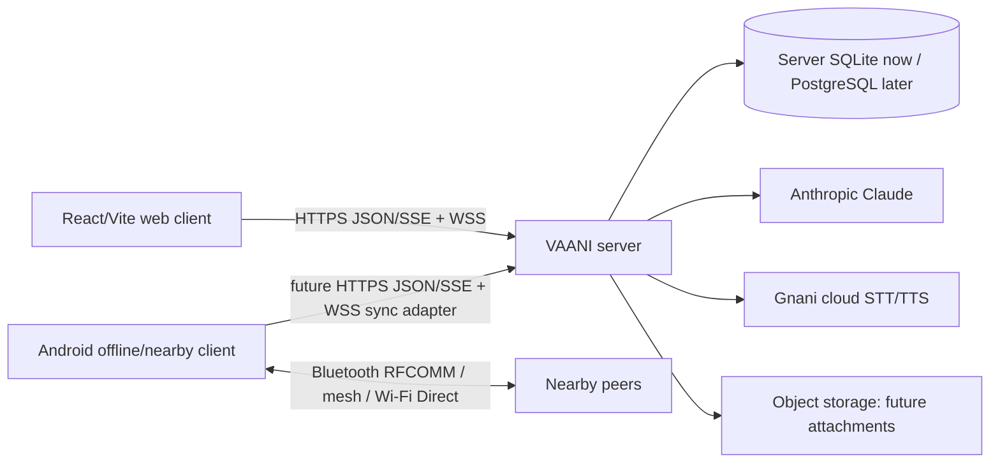

# VAANI Canonical Architecture

**Status:** reconciled design; no runtime merger has been performed. This supersedes conflicting assumptions in the web-only architecture document while preserving the Claude Design UI and Android source.

## System context

## Canonical ownership

| Concern | Canonical owner | Current implementation | Status |
|---|---|---|---|
| Web UX | `client/` | Claude Design React transcript UI | Preserved; source present, not independently browser-tested in this environment |
| Internet API/business rules | `server/` | Express routes + `Store` + authenticated WebSocket hub | Canonical persistent communication backend; local regression tested |
| Cloud persistence | `server/src/db.ts` | `node:sqlite`, FTS5, WAL, in-code `user_version` migration | MVP single-instance store |
| AI orchestration | `server/src/ai/` | Claude provider, context/redaction, usage limits, structured actions | Mock/contract-tested only; no live key verification |
| Cloud speech | `server/src/speech/gnani.ts` | Gnani STT/TTS adapters | Mock/contract-tested only; no live verification |
| Android nearby/offline transport | `app/` | Room, Bluetooth RFCOMM, mesh/store-forward, Wi-Fi Direct path, local STT/TTS | Client-specific; Android build/device verification blocked by missing SDK/device |
| Earlier Android proxy | `backend/` | Minimal Claude proxy | Not a production backend; do not deploy alongside `server/` |

## Client boundaries

### Web client
The web client uses a VAANI bearer session token for REST/SSE and WebSocket access. It must not access Claude/Gnani keys. Its in-memory outbox is a UI resilience mechanism, not the source of truth; SQLite message history and canonical message IDs recover missed events after reconnect.

### Android client
The Android client retains its existing device-local identity, Room state, offline queues, and nearby protocol. A future `server-sync` module must use the canonical API below. It must not replace Bluetooth/mesh delivery with cloud delivery, and must not send legacy peer IDs or Room message IDs as canonical server IDs.

### Shared backend eligibility

| Capability | Shared now? | Reconciliation decision |
|---|---:|---|
| Authentication/user identity | Web only | Server account identity becomes canonical for cloud functions. Android account/session integration is future work. |
| Conversations/members/messages | Web only | Server IDs are canonical for cloud conversations. Android keeps a mapping table for nearby/offline messages. |
| Group membership/search/reactions | Web only | Reuse server API when Android cloud sync is added; do not duplicate rules. |
| Realtime delivery/read/presence | Web only | Reuse server WebSocket contract. Nearby ACK/delivery remains separate. |
| Claude/Gnani | Web only | Reuse server orchestrator/adapters after Android authentication exists. Local Android speech remains an independent offline capability. |
| Attachments/notifications | No | Add shared server modules before either client implements them. |

## Message and synchronization flow

1. A web client posts an idempotent `clientId`; the server verifies membership, persists, then fans out `message.new` over WSS. HTTP acceptance is **sent to server**, not peer delivery.
2. A recipient marks a message read; the server stores the member read cursor and emits `read`.
3. An Android nearby message remains in Room and uses the existing packet ACK/mesh semantics. Future cloud sync uploads it through the canonical server API using a new stable `clientMessageId` and stores the resulting server ID mapping.
4. Sync must be append-only/idempotent, preserve original text/audio, and never manufacture a delivered state from a local queued or nearby transport state.

## Security boundaries

- Provider keys are server environment variables only.
- `Store.assertMember` is the current server authorization gate for conversation content.
- AI context is selected from the authorized conversation, bounded, and privacy-filtered before Claude requests.
- Gnani is cloud-only; Android local speech must never be labelled as Gnani or cloud speech as offline.
- Production requires TLS, a stable JWT key or managed identity provider, refresh/revocation design, encrypted backups, durable rate limits, and secret management.

## Deployment path

Current MVP: one Node process, one SQLite volume, WebSocket hub in-process, local WAV BLOBs. This is not horizontally scalable. Production evolution: managed PostgreSQL, object storage for attachments/audio, durable job queue for transcription, shared realtime broker, managed auth/session revocation, and observability.

## Android Cloud Sync Contract (v1.0 Designed)

A versioned, idempotent sync protocol has been designed for Android cloud integration:

- **Endpoint:** `POST /api/sync` with `X-Vaani-Sync-Version: 1`
- **Identity mapping:** Local UUIDs → server integer IDs via `CloudIdMappingEntity`
- **Idempotency:** `clientId` (local UUID) ensures duplicate uploads return existing message
- **Cursor-based:** Opaque cursor tracks sync position; supports incremental and recovery sync
- **Conflict resolution:** Server-authoritative; last-write-wins for concurrent edits
- **Offline:** Local operations succeed offline; sync reconciles when online

See [ANDROID_CLOUD_SYNC_CONTRACT.md](./ANDROID_CLOUD_SYNC_CONTRACT.md) for full protocol specification.
See [ANDROID_SYNC_DATA_MODEL.md](./ANDROID_SYNC_DATA_MODEL.md) for Android schema extensions.

**Status:** Server endpoint and Android sync module are implemented. Android build/device verification is blocked by the unavailable Android SDK in this environment; local Android validation remains required.
